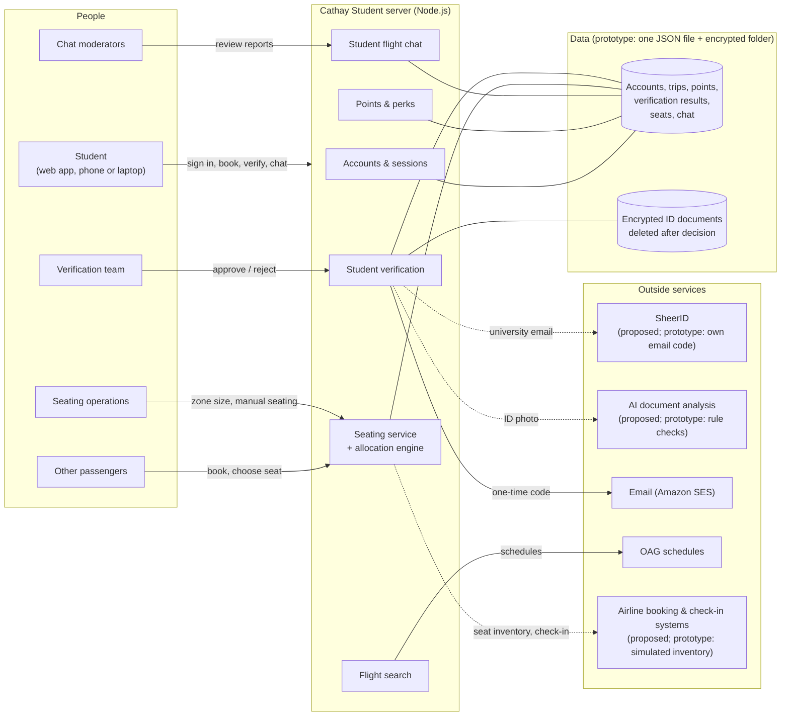
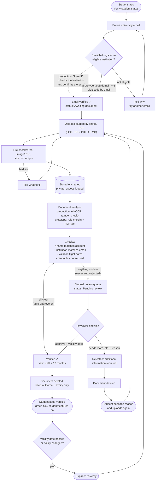
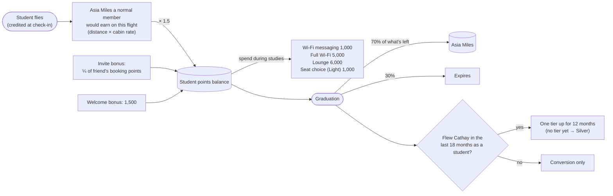
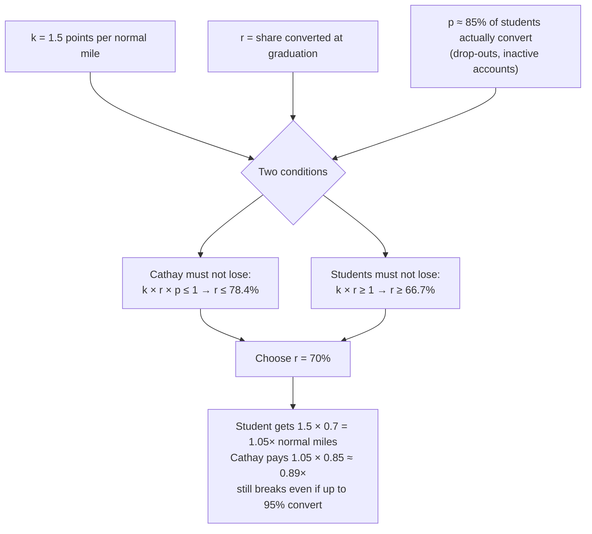
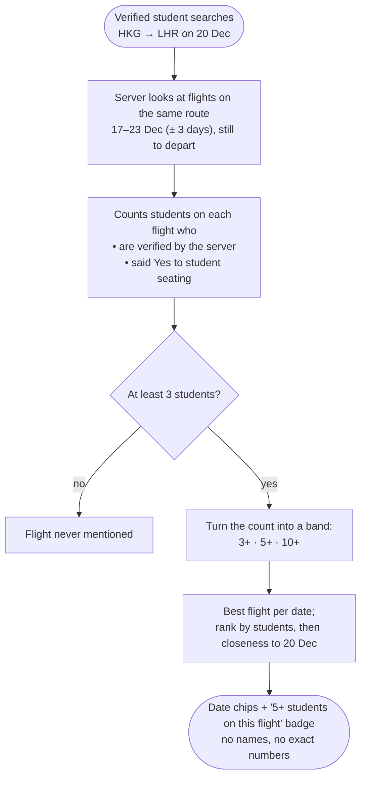
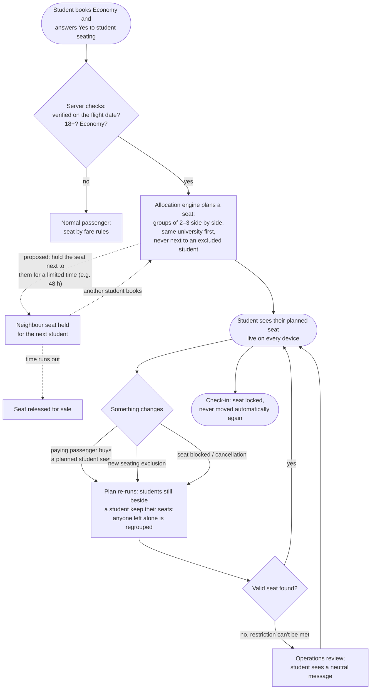
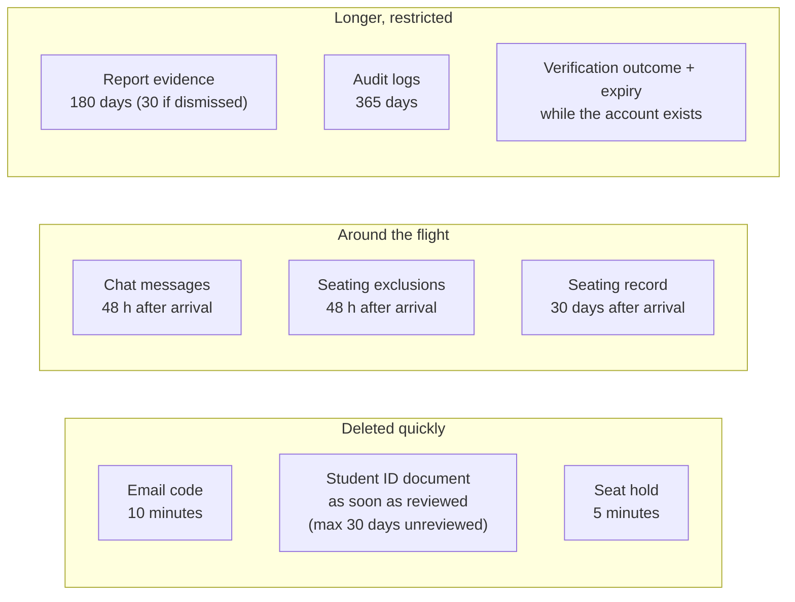

# Systems and data flows: Cathay Student

Simple diagrams of how the system fits together and how data moves through it.

**Notation:**
- Solid arrows are built in the prototype.
- **Dashed arrows and "proposed" boxes** are the production design or ideas not yet built.
- Each diagram says what the prototype does today.

Contents:
1. System overview
2. Student verification: data in, decision back to the student
3. Student points: 1.5×, spending, 70% at graduation, Silver / tier-up for 12 months
4. "Fly with other students" (hot pick): how dates are chosen and why counts are shown in bands
5. Student seating: from booking to check-in
6. What we keep, and for how long

---

## 1. System overview

---

## 2. Student verification: data in, decision back to the student

The student gives two things: a **university email** and a **photo of their student ID**. The diagram follows both until a result reaches the student.

What the student sees at each stage: **Not submitted → Awaiting document → Pending review → Verified**, or **Rejected (more info)** and **Expired**, each with its next step.

---

## 3. Student points: earning, spending and graduation

**Why 1.5× and 70%?**

**Why the 18-month rule for the tier upgrade:** it goes only to students who actually flew Cathay near the end of their studies, so the cost (mainly a few lounge visits) is spent on active customers just before they start travelling for work. It also encourages one more booking before graduation. *(Assumptions to validate with Cathay's real data.)*

---

## 4. "Fly with other students" (hot pick)

When a verified student searches a route, the app suggests nearby dates whose flights already have the most students.

**The statistical reasoning:**
- **Minimum of 3:** a flight with 1 or 2 students is never shown. Otherwise "1 student on CX 251" plus a friend's post that they're flying would identify them. With at least 3, any one student is hidden among the others (k-anonymity, k = 3).
- **Bands, not exact numbers:** if the app showed exact counts, someone could watch "4 → 5" right after a friend booked and learn something about that person. Bands only change at 3, 5 and 10, so most single bookings change nothing visible.
- **Only verified students who opted in** are counted, so the number can't be inflated by unverified accounts, and nobody is counted without choosing student seating.
- **± 3 days** is wide enough to offer a real choice, and narrow enough that the suggestion is still useful for most travel plans.
- **Uses our own bookings**, so no extra calls to the schedule provider (OAG) and no extra cost.

---

## 5. Student seating: from booking to check-in

Default today is **dynamic seating**: no seats are reserved; students are planned next to each other anywhere in Economy.

**Fare rules on top:**
- **Economy Light:** students still get a seat for free, but can't choose one, unless they buy seat selection.
- **Essential and Flex:** students can choose their own seat, and the system won't take it from them.

**Alternative mode (`SEATING_MODE=zone`):** reserved Student Zone rows instead of dynamic planning. See `docs/SEATING.md`.

---

## 6. What we keep, and for how long

All periods are proposals for legal review (Hong Kong PDPO).
