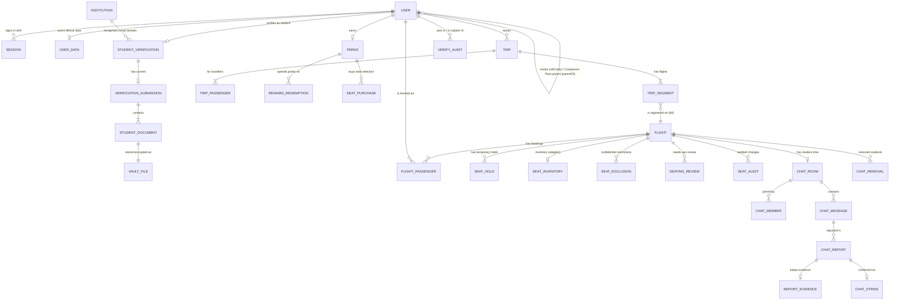
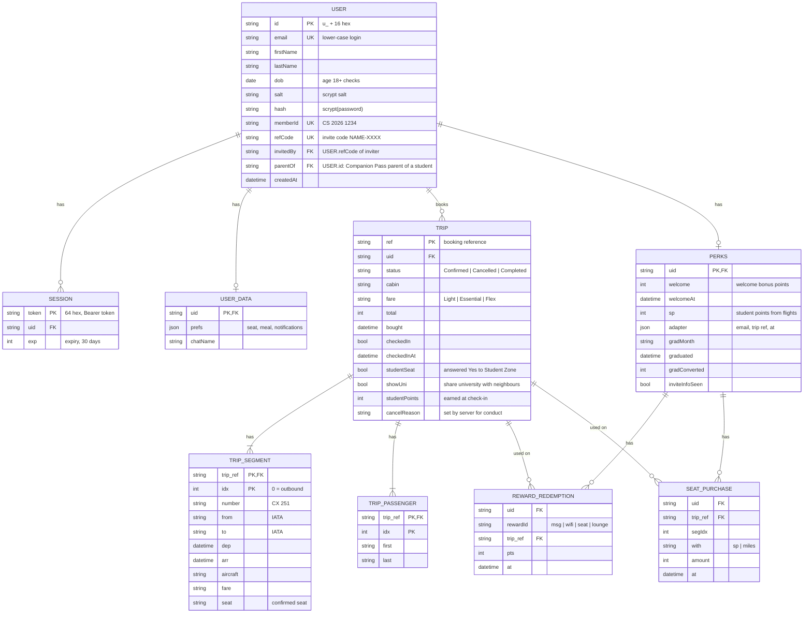
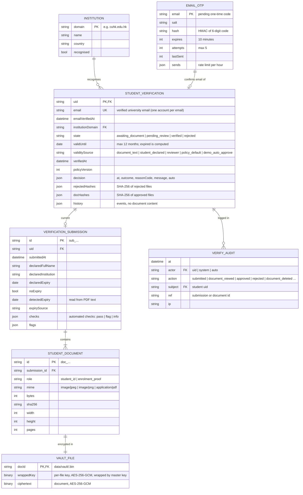
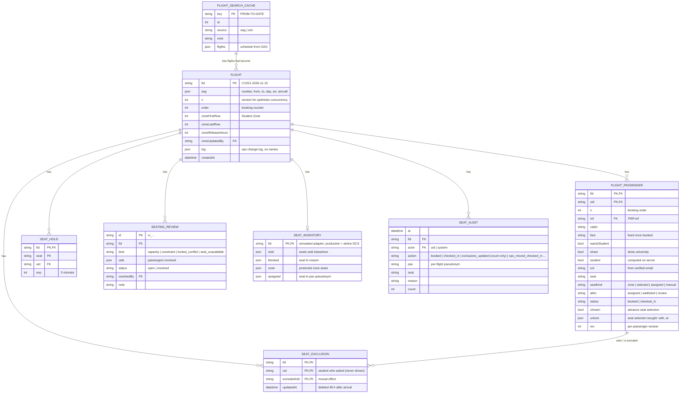
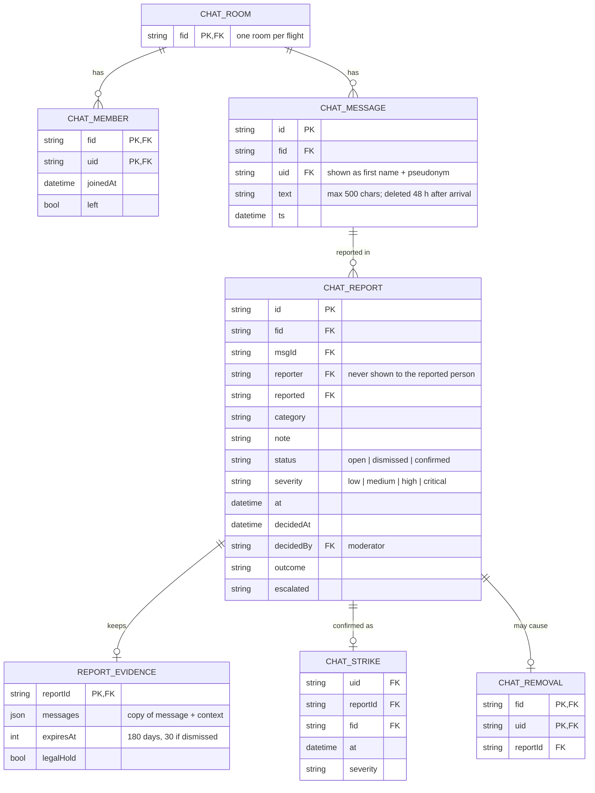

# Data model (ERD): Cathay Student

The whole data layer of the app, drawn as a **logical** model: each nested object in today's JSON database is shown as the table it would become in a production database. Field names are the real ones in the code. The table at the end says where each entity lives today and where it should live in production.

**Notation:**
- `PK` primary key, `FK` foreign key, `UK` unique.
- `||--o{` one-to-many, `||--o|` one-to-zero-or-one.
- `fid` is a flight id, e.g. `CX251-2026-11-15` (flight number + departure date).
- `uid` is an account id (`u_…`).

## 1. Overview

## 2. Accounts, trips and perks

## 3. Student verification

## 4. Flights, seats and the Student Zone

## 5. Student flight chat and moderation

## 6. Where each entity lives

| Entity | Today (prototype) | Production target |
|---|---|---|
| USER, SESSION | `db.users`, `db.sessions` (`data/live-db.json`, `accounts.js`) | Customer identity system / Cognito; sessions in a TTL table |
| USER_DATA, TRIP, TRIP_SEGMENT, TRIP_PASSENGER, PERKS, REWARD_REDEMPTION, SEAT_PURCHASE | `db.userData[uid]` (`trips`, `prefs`, `perks`, `chatName`), synced from the device via `PUT /api/me/data` | Trips from the airline's **reservation system (PNR)**; points and perks in a server-side **loyalty ledger** |
| STUDENT_VERIFICATION, VERIFICATION_SUBMISSION, STUDENT_DOCUMENT | `db.studentVerify[uid]` (`student-verify.js`) | Verification table (DynamoDB / RDS) |
| VAULT_FILE | `data/vault/<docId>.bin`, AES-256-GCM | Private S3 bucket, SSE-KMS, lifecycle deletion |
| INSTITUTION | Code (`INSTITUTIONS` in `student-verify.js`) | Airline-maintained eligible-institution list |
| VERIFY_AUDIT | `db.verifyAudit` | Append-only audit log (TTL 365 days) |
| EMAIL_OTP | In memory (`server.js`); DynamoDB `CodeTable` in the AWS Lambda edition (`aws/lambda/store.js`, TTL) | DynamoDB with TTL |
| FLIGHT_SEARCH_CACHE | `db.searches` (`live.js`) | Cache (e.g. ElastiCache / DynamoDB TTL) |
| FLIGHT, FLIGHT_PASSENGER, SEAT_HOLD, SEATING_REVIEW | `db.flights[fid]` (`seating/service.js`, `seating/repository.js`) | `SeatingFlights`, `SeatingPassengers`, `SeatingAssignments` (one item per seat), `SeatingHolds`; see `docs/SEATING.md` §10.2 |
| SEAT_EXCLUSION | `db.seatPrefs[fid][uid].excludes` (kept apart from flights on purpose) | Separate KMS-encrypted `SeatingPreferences` table, TTL arrival + 48 h |
| SEAT_INVENTORY | `db.inventory[fid]` (simulated adapter) | The airline's inventory / departure-control system, via `InventoryAdapter` |
| SEAT_AUDIT | `db.seatAudit` | Append-only audit log (TTL 365 days) |
| CHAT_* , REPORT_EVIDENCE | `db.chat.rooms`, `.reports`, `.evidence`, `.strikes`, `.removed` (`chat-server.js`) | Chat and moderation tables; evidence in a restricted store with legal hold |

**Not stored anywhere (memory only):**
- live-update tickets for seating and chat (60 s, single use);
- open live connections;
- rate-limit counters.

**Secrets outside the data model:**
- `db.seatSecret`: HMAC key for per-viewer participant handles.
- The document master key: `DOC_ENCRYPTION_KEY` in `.env`, or `data/vault/.key` in demo mode.
